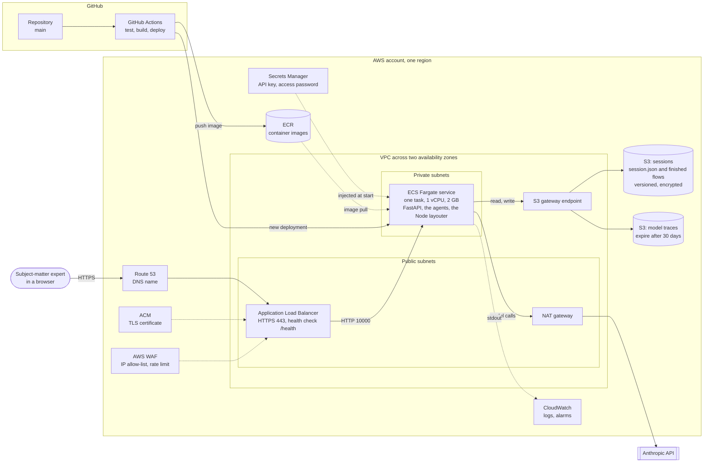

# Deploying to AWS (planned)

The service runs on Render today: one Docker container, sessions on a disk that is wiped on
every restart, one shared password. This is the plan for moving it to AWS, where sessions
become durable and the deployment is something a team can own. **Nothing here is built yet.**
The container is unchanged; what changes is where it runs and where it keeps its state, and
the [code changes](#code-changes-this-needs) are listed at the end.

The same diagram as Mermaid, which GitHub and most editors render, and which is the copy to
edit — the SVG is generated from it:

## How a request travels

1. The browser resolves the service's name in **Route 53** and connects to the **Application
   Load Balancer** over HTTPS, with the certificate from **ACM**.
2. **AWS WAF** in front of the load balancer lets in only the organisation's address ranges
   and caps the request rate per address. The application's own shared password
   (`PFG_ACCESS_PASSWORD`) still applies behind it. No Cognito: the password and the
   allow-list together are the door, as they are a door on Render.
3. The load balancer forwards to the one **ECS Fargate** task on port 10000. Its health check
   is `/health`, which is outside the password for exactly this reason.
4. The task reads and writes sessions in the **sessions bucket** through an S3 gateway
   endpoint, so that traffic never leaves the VPC and costs nothing in NAT data charges.
5. Model calls go out through the **NAT gateway** to the Anthropic API. That is the only
   traffic that leaves AWS.

Every turn is still start-and-poll, so nothing holds a connection open longer than the load
balancer's default 60-second idle timeout.

## The pieces

| Service | What it does here | Why this and not something else |
| --- | --- | --- |
| **ECS Fargate** | Runs the existing image, unchanged in what it contains | No servers to patch, and the image already carries Python and Node together. Lambda does not fit: a first turn runs for minutes and calls a Node subprocess |
| **S3, sessions** | Each session's `session.json` and its finished flows, under `sessions/<id>/` | Sessions are whole documents written after each turn, which is what S3 holds well. No query ever needs more than one session or a list of ids. Versioning means an overwritten session can be recovered |
| **S3, traces** | The model trace (`trace.jsonl`), one object per session per day | The trace holds every prompt and answer in full. It is a debugging aid, so it expires after 30 days rather than accumulating |
| **ECR** | The container images | Where Fargate pulls from, with image scanning on push |
| **Application Load Balancer** | HTTPS, health checks, one stable address | A Fargate task's address changes on every deployment |
| **AWS WAF** | Address allow-list and rate limit | The application has no accounts; this keeps strangers from reaching the password prompt at all |
| **Secrets Manager** | `ANTHROPIC_API_KEY` and `PFG_ACCESS_PASSWORD` | Injected into the task's environment by the task definition, so neither is in the image, the repository or the console's plain-text settings |
| **CloudWatch** | The application log (it already writes to stdout) and alarms | An alarm on unhealthy targets and on task restarts is enough to know it is down |
| **Route 53, ACM** | A name and a certificate | A stable URL to share |
| **NAT gateway** | Outbound internet for the task | The task sits in private subnets and needs to reach the Anthropic API |

### Settings in the task definition

| Variable | Value |
| --- | --- |
| `ANTHROPIC_API_KEY` | From Secrets Manager |
| `PFG_ACCESS_PASSWORD` | From Secrets Manager |
| `ANTHROPIC_WORKSPACE_ID` | Only if the key is not scoped to a workspace |
| `PFG_SESSIONS_BUCKET` | The sessions bucket's name — *new; selects the S3 store* |
| `PFG_TRACE_BUCKET` | The traces bucket's name — *new; sends the trace there* |
| `PFG_LOG_LEVEL` | `INFO` (the image's default) |

The task's IAM role can read and write only the two buckets, under their prefixes. The
execution role can pull from ECR, read the two secrets and write to CloudWatch. Nothing else.

## Decisions in this design

**One task, and deployments that replace it rather than overlap it.** Which sessions have a
turn running is held in the task's memory, so two tasks could each accept a turn on the same
session. The service runs at a desired count of one, with a deployment configuration of
minimum healthy 0 % and maximum 100 %: the old task stops before the new one starts. That
costs a few seconds of downtime per deployment, and it is the same rule Render runs under.
A turn in flight when the old task stops is already handled — the next read of that session
reports the turn as interrupted and asks for the message again, and nothing is lost from the
session file. Running more than one task later needs a shared lock (a DynamoDB item written
with a condition, or a conditional S3 write) in place of the in-memory set.

**S3, not a database.** The session store is already a protocol with five operations, and
each maps onto S3 directly: `create` is a put that must not overwrite (`If-None-Match: *`),
`save` a put that must match the version last read (`If-Match`), `load` a get, `list` a
listing of the `sessions/` prefix. Conditional writes give the same guarantee the file store
gets from write-then-rename: a reader sees a session before a turn or after it, never half of
one. A database would add a second kind of storage without a query that needs it.

**The page is served by the container, not from S3 and CloudFront.** Serving `frontend/dist`
from S3 behind CloudFront is the usual pattern, but here it would split one origin into two,
bring back the cross-origin setup the single-URL design removed, and put the page outside the
password. The container already serves it. CloudFront can be added in front of the load
balancer later without changing that.

**Private subnets and a NAT gateway.** The task has no public address and accepts traffic
only from the load balancer's security group. The NAT gateway is the largest fixed cost in
the design; the cheaper alternative is to run the task in a public subnet with a public
address, still locked to the load balancer by its security group. That is a reasonable
choice for a pilot and an easy one to reverse.

**Seed sessions become a one-time upload.** On Render, `seed_sessions/` is restored at every
boot because the disk is wiped. On AWS sessions persist, so the seeds are copied into the
bucket once (restoring only where missing, the rule `restore_seeds` already follows) and from
then on behave like any other session — changes to them stick.

**Data handling.** Sessions and traces hold whatever users typed. Both buckets block public
access and are encrypted at rest; the sessions bucket is versioned; the traces bucket expires
objects after 30 days. If anything resembling patient information could ever be entered,
that needs its own review before go-live — this design does not assume it.

## Code changes this needs

The container stays the same image; these are the changes inside it.

1. **`S3SessionStore`** in `session/store.py`, implementing the existing `SessionStore`
   protocol with `boto3` (already installed, via Strands), chosen when `PFG_SESSIONS_BUCKET`
   is set. The file store stays the default for laptops and tests.
2. **Finished flows through the store, not a local path.** `path_for_outputs` hands callers
   a local folder, which close-out writes into and the API reads from. On S3 there is no such
   folder. It becomes two operations: write a flow's files (close-out builds them in a
   temporary folder, as it effectively does now, and the store uploads them) and read one
   file back (the API streams it, or redirects to a short-lived presigned URL).
   `session/closeout.py`, `api/sessions.py` and `session/cli.py` change to match.
3. **A trace sink for S3**, chosen by `PFG_TRACE_BUCKET`, appending to one object per
   session per day instead of the local `logs/trace.jsonl`.
4. **Settings** for the two bucket names in `utils/settings.py`.
5. **Infrastructure as code** for everything in the diagram — AWS CDK in Python, to stay in
   the project's language — and a GitHub Actions workflow that runs the tests, builds the
   image, pushes it to ECR and starts a new deployment, signing in to AWS through OIDC so no
   long-lived AWS keys are stored in GitHub.

None of this touches the agents, the pipeline, stages 2 and 3, or the page.

## Rough monthly cost

At list prices in `us-east-1`, running all month — an estimate to check against the AWS
Pricing Calculator, not a quote. Model usage is billed by Anthropic and is not included.

| Item | Approximate |
| --- | --- |
| Fargate, 1 vCPU and 2 GB, always on | $36 |
| Application Load Balancer | $18–22 |
| NAT gateway, plus a little data | $33–35 |
| AWS WAF, one web ACL and a few rules | $6–8 |
| S3, Secrets Manager, CloudWatch, Route 53 | under $5 |
| **Total** | **about $100** |

Dropping the NAT gateway (task in a public subnet) brings it to about $65.
